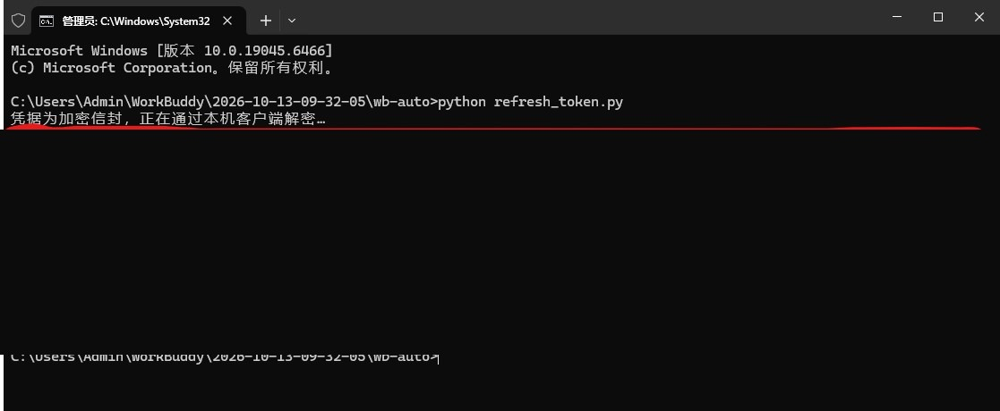
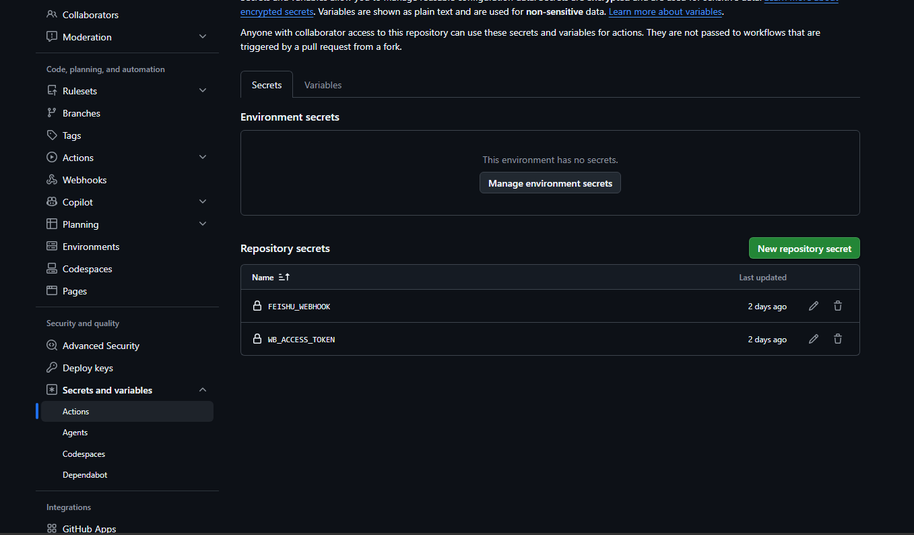

# workbuddy_auto_checkin

WorkBuddy「Buddy 加油站」的每日自动化：**签到领积分**、**派猫猫旅行并领回礼物**，结果推送到飞书。

跑在 GitHub Actions 上，按 cron 每天定时执行，不需要任何常开设备。

> **两种运行方式，签到逻辑完全一致，二选一：**
>
> | | GitHub Actions 版（本 README） | [WPS 金山文档版](wps/README.md) |
> | --- | --- | --- |
> | 适合 | 习惯 GitHub 的用户 | **不想碰 GitHub / 零命令行** 的用户 |
> | 托管 | GitHub Actions 免费定时任务 | 金山文档智能表格脚本 + 免费定时任务 |
> | 配置 | Fork 仓库 + 填两个 Secret | 建表格 → 粘脚本 → 填两个单元格 |
> | 结果 | Actions 日志 / 飞书卡片 | 直接回写表格 / 飞书卡片 |
>
> 两种版本的 token 都由本机导出一次（[第 4 步](#第-4-步导出登录凭证二选一)）：
> 装了 Python 就跑 `refresh_token.py`；没装 Python 直接下载仓库里的
> **`refresh_token.exe`** 双击运行，无需任何环境。

## 特性

- **云端定时** — 免费 runner + `schedule` 触发，本机关机照常执行
- **多账号** — 一个仓库托管多个 WorkBuddy 账号，各用一份令牌、各推一张卡片
- **一次做两件事** — 签到与成长中心旅行在同一次运行里完成
- **幂等** — 先查状态再决定是否领取；已签不重领，已派不重派
- **结论解耦** — 猫猫模块任何异常都不影响签到结论；整体成败只看签到
- **零明文入库** — 仓库不含任何凭据；token 由本机脚本导出后写入 GitHub Secret

## 工作原理

```text
本机（一次性）                      GitHub                           外部
┌──────────────────┐    gh secret   ┌────────────────────┐
│ refresh_token.py │ ─────────────► │ Secret:            │
│  读登录态 → 解密 │                │  WB_ACCESS_TOKEN   │
└──────────────────┘                │  FEISHU_WEBHOOK    │
                                    └─────────┬──────────┘
                                              │ 每天 cron
                                    ┌─────────▼──────────┐        ┌──────────────┐
                                    │ Actions: wb_auto.py│ ─────► │ copilot.     │
                                    │  签到 / 领奖 / 派出│ ◄───── │ tencent.com  │
                                    └─────────┬──────────┘        └──────────────┘
                                              │ webhook
                                    ┌─────────▼──────────┐
                                    │ 飞书群机器人卡片    │
                                    └────────────────────┘
```

### 为什么 token 必须在本机导出

桌面端把会话写在 `workbuddy-desktop.info` 里，其中 `accessToken` 是 Electron `safeStorage` 保护的 `$wbEncrypted` 信封（AES-256-GCM，密钥由客户端运行时持有）。云端 runner 既没有这份文件，也没有解开它所需的运行时，因此**无法在云端现取 token**。

`refresh_token.py` 的做法是：读出加密信封 → 以 `ELECTRON_RUN_AS_NODE=1` 起一个 WorkBuddy 子进程 → 把信封通过 stdin 递进去，由客户端自己的运行时解密 → 从 stdout 取回明文 token。解密材料全程不落盘。

## 快速开始

### 开始前要有

- 一个 GitHub 账号
- 一台装过 WorkBuddy **并且登录过**的电脑（只在配置时用一次）
- 一个飞书群（自己建一个只有自己的也行），用来收消息
- 电脑上有 Python 3.8+（没有也行——用仓库里的 `refresh_token.exe`，见第 4 步）

### 容易搞混的一点，先说清楚

下面所有命令和配置里出现的仓库名，指的都是**你自己**的那个仓库（`你的用户名/workbuddy_auto_checkin`），**不是**原作者的 `FXmonkey/workbuddy_auto_checkin`。原作者的仓库只是让你 Fork 的源头，你的凭证和定时任务都配在你自己的仓库里。

### 第 1 步：把项目复制到自己账号下

两种方式都行，**推荐 Fork**，一键搞定：

**方式 A：Fork（推荐）**

1. 打开项目页 `https://github.com/FXmonkey/workbuddy_auto_checkin`
2. 点右上角 **Fork** → **Create fork**
3. 完成后你就有了 `你的用户名/workbuddy_auto_checkin`
4. **fork 完必须多做一步**：进你 fork 出来的仓库 → 点上方 **Actions** 页签 → 页面中间会有一行提示，点 **I understand my workflows, go ahead and enable them** 启用。**不启用的话定时任务不会跑。**

**方式 B：新建仓库再上传**

1. GitHub 右上角 **+** → **New repository**，名字随便填，选 **Private**，点 **Create repository**
2. 仓库页点 **Add file → Upload files**
3. 把整个项目文件夹拖进去（**必须包含 `.github` 这个文件夹**，它是定时任务的定义），点 **Commit changes**

> 两种方式的取舍：Fork 少一步，但要多做上面第 4 小步的启用；新建仓库没有这个坑，但网页上传时容易漏掉 `.github` 这种以点开头的文件夹。二选一即可。

### 第 2 步：把脚本下载到自己电脑

后面要在你电脑上跑一次脚本导凭证，所以先把代码拿到本地。两种都行：

- 网页下载：你的仓库页 → 绿色 **Code** 按钮 → **Download ZIP** → 解压
- 或用 git：`git clone https://github.com/FXmonkey/workbuddy_auto_checkin.git`

### 第 3 步：拿一个飞书机器人地址

1. 在飞书里建一个群（只有你自己也行）
2. 群设置 → **群机器人** → **添加机器人** → **自定义机器人**
3. 复制它给你的地址，形如 `https://open.feishu.cn/open-apis/bot/v2/hook/xxxxxxxx`

### 第 4 步：导出登录凭证（二选一）

**先选运行形式：**

- **没装 Python？** 直接双击仓库里的 **`refresh_token.exe`**（用法与 `.py` 完全一致，把下面命令里的 `python refresh_token.py` 换成 `refresh_token.exe` 即可）。首次运行 Windows SmartScreen 可能拦截，点 **更多信息 → 仍要运行**。
- 装了 Python：继续往下按命令操作（脚本零第三方依赖，只需 Python 3.8+）。

**方式 A：电脑上装了 gh CLI —— 自动写入，最省事**

在项目文件夹里运行：

```
python refresh_token.py --gh-repo 你的用户名/workbuddy_auto_checkin
```

脚本会解密并直接把 token 写进你仓库的 Secret，屏幕显示「已写入」即可跳到第 5 步。

**方式 B：没装 gh CLI —— 先打印出来，再手动粘贴**

在项目文件夹里运行：

```
python refresh_token.py
```

屏幕上会打印一长串字符（下图涂黑的部分就是它），**完整复制 `----- 以下为 token -----` 到 `----- 以上为 token -----` 之间**的内容，下一步手动粘进 GitHub。




### 第 5 步：把两个 Secret 填进仓库

打开**你自己的仓库** → **Settings** → 左侧 **Secrets and variables** → **Actions** → 点绿色的 **New repository secret**：



需要填两条：

| Name | Secret 里填什么 |
| --- | --- |
| `WB_ACCESS_TOKEN` | 第 4 步方式 B 复制的那串字符 |
| `FEISHU_WEBHOOK` | 第 3 步拿到的飞书机器人地址 |

> 方式 A 已经自动写入 `WB_ACCESS_TOKEN` 的，这里只需要再填 `FEISHU_WEBHOOK` 一条。
> 填完这个页面应该能看到两条记录（如上面截图所示）。

### 第 6 步：手动跑一次验证

1. 打开你的仓库 → 点上方 **Actions** 页签
2. 左侧选 **Buddy 加油站每日自动化**
3. 右侧点 **Run workflow** 下拉，再点绿色的 **Run workflow**
4. 等十几秒，刷新页面，飞书应该收到一条消息

> 这个页面显示绿色不代表签到一定成功（猫猫出问题不影响整体结论）。**以飞书收到的消息为准。**

## 多账号（一个仓库跑多个 WorkBuddy）

同一个仓库可以托管多个账号的签到，互不干扰：各自一份 token、各自一张飞书卡片、各自独立的运行记录；一个账号失败不影响其它账号。

### 要配的东西只有两样

**① 每个账号一条令牌 Secret**

| 账号 id | 令牌 Secret | 卡片推到哪 |
| --- | --- | --- |
| `MAIN`（默认，可省略不写） | `WB_ACCESS_TOKEN` | `FEISHU_WEBHOOK` |
| `WORK` | `WB_ACCESS_TOKEN_WORK` | `FEISHU_WEBHOOK_WORK`（可省略，省略即用全局的 `FEISHU_WEBHOOK`） |

规则很直白：**`WB_ACCESS_TOKEN_` + 大写的账号 id**。

**② 一份账号清单（仓库变量，不是 Secret）**

仓库 → Settings → Secrets and variables → Actions → **Variables** 页签 → **New repository variable**：

| Name | Value |
| --- | --- |
| `WB_ACCOUNTS` | `[{"id":"MAIN","label":"主号"},{"id":"WORK","label":"工作号"}]` |

`label` 只影响飞书卡片标题和 Actions 里的任务名，随便起。这个变量**不含任何凭据**，所以放在 Variables 而不是 Secrets。

> **不建这个变量也能跑**：workflow 会退化成单账号模式，直接用 `WB_ACCESS_TOKEN`，与你现在的用法完全一致。想加号时才需要它。

### 每台机器各自导出自己的那份

token 只能由登录了该账号的客户端解出来，所以**一个账号对应一台电脑**：

```text
# 主号那台（不写 --account，仍然写 WB_ACCESS_TOKEN）
python refresh_token.py --gh-repo 1024210879/workbuddy_auto_checkin

# 工作号那台
python refresh_token.py --gh-repo 1024210879/workbuddy_auto_checkin --account WORK
```

自动续期同样按账号来，账号 id 会一并固化进启动项：

```text
powershell -ExecutionPolicy Bypass -File scripts\setup_task.ps1 -Repo 1024210879/workbuddy_auto_checkin -Account WORK
```

### 两台机器分工时，出问题先跑 `--status`

多台机器各管一个账号，最容易撞上的两件事都不是「令牌过期」，但现象都是 401：

```text
# 只读诊断：不解密、不写入，把三处数据摆在一起
python refresh_token.py --gh-repo 1024210879/workbuddy_auto_checkin --account WORK --status
```

| 提示 | 实际发生了什么 | 怎么办 |
| --- | --- | --- |
| `比本机记录新 N 分钟 → 有人在脚本之外改过` | 有人在网页上手工粘贴、或另一台机器推过一次，本机 `state.json` 看不见这次写入，闸门就会误判「不用重推」 | 确认来源后 `--force` 重推一次，让本机记录与远端对齐 |
| `[串号] 本机登录身份 …，但该 Secret 上次由身份 … 推送`（exit 5） | 这台机器登录的不是那个账号，把 A 的令牌推到 `WB_ACCESS_TOKEN_B`，B 会一直 401 | 去登录该账号的那台机器同步；确实要覆盖再 `--force` |
| 结论「这台机器从未推送过 X，但远端已经有它 → 多半是另一台机器在管」 | 本机 `state.json` 没有 X 的记录，远端却已有 `WB_ACCESS_TOKEN_X`——通常是另一台机器在负责它，或有人在网页上手工粘过 | 别在这台机器推（推了就是串号）；到 X 登录的那台机器跑 `--status` |
| `其中 MAOXY 本机从未同步过` | 远端有这个账号的 Secret，但这台机器从没推过它 | 别在这台机器 `--account` 它 |

首次推送时脚本会把「本机登录身份」的哈希（12 位，不含任何身份明文）记进 `state.json` 的 `idf`，之后每次同步都对不上就报错。凭据里没有可用的身份字段时不判定，只提示——这时用 `--expect-identity ask` 人工确认。

顺便把机器名也写进账号清单，失败卡片就会直接点名该去哪台机器操作（`host` 可选，不填不影响任何行为）：

```text
[{"id":"MAIN","label":"主号","host":"办公机"},{"id":"WORK","label":"工作号","host":"游戏本"}]
```

### 加号前后会变什么

- **执行方式**：workflow 先读 `WB_ACCOUNTS`，再按账号矩阵**并行**跑；每个账号一个 job，日志、step summary 分开，`fail-fast: false` 保证互不牵连
- **飞书卡片标题**变成 `Buddy 加油站 · 工作号 · 成功`，多个账号的卡片混在一个群里也分得清
- **并发控制**：同一账号的多个时段仍然串行（`wb-daily-<ID>`），不同账号之间互不阻塞
- **令牌缺失不会串号**：某个账号的 Secret 没配，那个 job 直接报「Secret `WB_ACCESS_TOKEN_WORK` 没有值」并退出（现在也会推一张卡片说明是哪一个），不会偷偷用别的账号的令牌
- **本机侧也会挡串号**：把 A 的令牌推到 `WB_ACCESS_TOKEN_B` 时，`refresh_token.py` 用身份指纹对不上就直接 exit 5（详见上一节）

### 几个容易踩的点

| 情况 | 说明 |
| --- | --- |
| id 大小写 | 统一转大写，`work` 与 `WORK` 是同一个账号；只允许字母、数字、下划线 |
| 想换 Secret 名 | 在清单里加 `"secret":"MY_TOKEN"` 显式指定，不再按默认规则拼 |
| 一台机器两个账号 | 需要两套客户端登录态（各自的凭据文件），实际很少见；真要用就给其中一份设 `WORKBUDDY_AUTH_FILE` 指向不同文件 |
| 私有仓库额度 | 每个账号每天 3 次运行，矩阵会成倍消耗额度（公开仓库不计时） |
| 加号后记得验证 | 手动 Run workflow 一次，看是不是每个账号各出一张卡片 |

## 令牌自动续期（可选）

token 有效期 28 天。手动重跑一次脚本能用一个月，但很容易忘。做成本机计划任务后就不用再管。

### 原理：刷新工作交给客户端，脚本只负责搬运

桌面端每次启动都会自己刷新一次令牌并写回凭据文件——所以 `lastRefreshTime` 与凭据文件的修改时间总是同一时刻，`refreshExpiresAt` 也随之顺延 30 天。这意味着：

> **只要这台电脑每 30 天内启动过一次 WorkBuddy，凭据文件里的令牌就永远是新鲜的。**

脚本不需要（也不应该）自己去调刷新接口，它只需把文件里那枚已经新鲜的令牌搬到 GitHub Secret。

### 三步配好

前提：装好 `gh` 并完成一次登录（只有它能写 Secret，且不需要把 token 复制来复制去）。

```
winget install --id GitHub.cli
gh auth login
```

然后在项目目录执行：

```
powershell -ExecutionPolicy Bypass -File scripts\setup_task.ps1
```

**直接回车即可** —— 脚本会自己问你两件事，不用记参数：

| 问题 | 怎么答 |
| --- | --- |
| `本机账号 id [回车沿用 <上次>]` | 填这个账号在 `WB_ACCOUNTS` 里的 id（如 `WORK`）；回车 = 沿用本机上一次的值。从来没有过则回车表示单账号模式（写 `WB_ACCESS_TOKEN`） |
| `GitHub 仓库 [回车 = 推断值]` | 回车即可，默认值由 `git remote origin` 自动推出，正常情况敲两次回车就完事 |

想跳过提问、纯脚本化调用，就把参数给全（参数齐全时不会出现任何提示）：

```
powershell -ExecutionPolicy Bypass -File scripts\setup_task.ps1 -Repo 你的用户名/workbuddy_auto_checkin -Account 你的ID
```

加 `-RunNow` 可当场试跑并回显日志。

脚本会做两件事：

1. **登录后 1 分钟自动跑一次同步**（计划任务 `WorkBuddyTokenRefresh`；权限不足时降级为「启动」文件夹，效果一样）
2. **在桌面生成「同步 WorkBuddy 令牌」快捷方式** —— 中途手动打开 / 重启客户端后，点它一下即可

快捷方式是**通用**的：执行的是 `scripts\run_refresh.cmd`（不带参数 = 手动模式），
双击后先问你 `本机账号 id`（回车沿用上次用过的，输入 `-` 表示单账号模式），再自动同步。
提示行会直接写出上次的账号，例如：

```
Account id [Enter = LINJJ, - = single-account mode]:
```

本机还没有同步记录时显示 `Account id [no last account yet, Enter = single-account mode]:`。
所以同一台机器上有多个账号时也只有一个图标，`.cmd` 里不会写死某台机器的 id。

整个过程不起常驻进程，用完就退。

**如果注册被拒绝**（普通账户未提升权限时会这样），脚本会自动降级为「启动」文件夹方式，不需要任何管理员权限：

- 在同一个 `scripts\run_refresh.cmd` 末尾追加一段 `--auto` 自动模式，并生成 `%APPDATA%\Microsoft\Windows\Start Menu\Programs\Startup\WorkBuddyTokenRefresh.vbs`
- 登录时 `vbs` 以隐藏窗口调用 `run_refresh.cmd --auto`，跑一次同步后就退出，没有常驻进程
- 自动模式不提问：账号来自安装时的 `-Account`，因为无控制台的 `.cmd` 里没法用 `set /p`
- `.cmd` 里只写 `%~dp0` 和 `%LOCALAPPDATA%`，安装路径/用户名带中文也不会变成 `?`
- 想恢复真正的计划任务，用管理员身份打开 PowerShell 重跑一次本脚本即可

一个入口两种模式（只有一个文件要维护）：

| 调用方式 | 场景 | 行为 |
| --- | --- | --- |
| `run_refresh.cmd` | 桌面快捷方式 / 手动双击 | 控制台窗口，先问账号（提示行显示上次账号，回车沿用，`-` 单账号），结束停窗 8 秒 |
| `run_refresh.cmd --auto` | `WorkBuddyTokenRefresh.vbs` 登录启动 | 无窗口、无提问，账号与轮询间隔来自 `setup_task.ps1` 的参数 |

「上次账号」的来源：`refresh_token.py` 每次跑完都会把账号写成一行纯文本
`%LOCALAPPDATA%\workbuddy_auto_checkin\last_account.txt`（内容 `LINJJ`，单账号模式则为 `-`），
`.cmd` 在提问前读它，所以不用先跑一遍就能看到上次用的是谁。

移除（两种方式都会一并清理）：`powershell -ExecutionPolicy Bypass -File scripts\setup_task.ps1 -Uninstall`
`/Uninstall` 会一并移除桌面快捷方式。

> 不想每次手动点？加 `-IntervalMinutes 5`，它会在登录那次之外再每 5 分钟跑一次短进程（仍然不是常驻）。

### 为什么「重启客户端后要点一下」

这是整套方案里最反直觉的一点：

> **WorkBuddy 客户端每次启动都会轮换 `accessToken`，旧令牌在轮换后立即失效。**

`expiresIn` 虽然是 28 天，但那只是「不再刷新的话能撑多久」。实际上你只要关掉客户端再打开一次，文件里就换了一枚新令牌，Secret 里那枚当场作废。

所以约定只有三条：

| 场景 | 要做的事 |
| --- | --- |
| 开机登录（客户端随后自己启动） | 不用管，登录后 1 分钟自动同步 |
| 中途关掉客户端又重新打开 | 点一下桌面「同步 WorkBuddy 令牌」，按提示答账号 id（提示行会写出上次的账号，回车沿用），随后自动同步 |
| 换机器 / 换账号 | 在新机器上跑一次 `setup_task.ps1`，按提示输入账号 id |

快捷方式执行的是 `run_refresh.cmd` → `refresh_token.py --ask-account --wait 60`：

- 账号提问在 `.cmd` 层用 `set /p` 完成（`pyw` 无标准输入，`--ask-account` 在那里不会提问）；提示行显示的「上次账号」来自 `last_account.txt`，回车 = 交给 `--ask-account` 沿用上次的账号，`-` = 单账号模式，输入 id 则直接 `--account <id>`
- 日志落在 `%LOCALAPPDATA%\workbuddy_auto_checkin\refresh-<ID>.log`；单账号/沿用上次走 `refresh.log`
- 凭据文件**最近两分钟内被写过**（说明客户端刚启动、可能还在刷新）→ 最多等 60 秒，一看到新令牌就立刻推送；
- 否则立刻判断，没变化就直接退出，不到 1 秒，不会让你干等。

### 新鲜度闸门：谁更新用谁

另一个坑：**如果本机超过 28 天没开机，凭据文件里躺着的是已过期的令牌**。此时无脑写入 Secret，会把里面原本还能用的那枚覆盖掉，定时任务立刻全线 401——比不刷新更糟。

所以判断依据是「本机这枚是否比 Secret 里的更新」，而不是「还剩几天」：

| 情况 | 行为 | 退出码 |
| --- | --- | --- |
| 本机令牌比记录里的**更新**（客户端刚轮换过） | 重推 Secret | 0 |
| 本机令牌不比记录里的新 | 跳过，省一次 API 调用 | 0 |
| 没有推送记录，且剩余 < `--min-days`（默认 3 天） | **跳过，不动 Secret** | 3 |
| 已经过期 | **跳过，不动 Secret**，提示先启动客户端 | 4 |
| 本机登录的身份，与该 Secret 上次记录的推送身份不一致（串号） | **不推送**，提示切到正确账号或 `--force` 覆盖 | 5 |

本地只在 `%LOCALAPPDATA%\workbuddy_auto_checkin\state.json` 里按 Secret 名分别记「已推送令牌的过期时刻 + 12 位指纹」，不含任何凭据。多账号时各记各的，不会互相把对方判成「已推送」。日志里也不会出现明文 token。

所以最坏的情况是：你出差一个月回来，任务跳过了一次，Secret 里仍是你离开前那枚——重新打开 WorkBuddy（客户端自动续期）后，2 秒内就会把新令牌同步上去，无需手工操作。

> `setup_task.ps1` 通过 `pythonw`/`pyw` 静默运行，不会弹黑窗口；日志在 `%LOCALAPPDATA%\workbuddy_auto_checkin\refresh.log`。
> 仓库里的 `refresh_token.exe` 是在本次改动之前打包的，不含新逻辑；如果你用 exe 手动刷新，建议改用 `python refresh_token.py`（或重新打包）。
> 具体说，`--status` 与 `--expect-identity` 两个参数**只存在于 `refresh_token.py`**，exe 里传会直接报「未知参数」。要做诊断或排查串号，请用 `py -3 refresh_token.py --status ...`。

### 不想装 gh 的替代做法

如果连 `gh` 都不想装，可以让整条链路都留在本机：用计划任务每天直接跑 `wb_auto.py`（把 `WB_ACCESS_TOKEN` 与 `FEISHU_WEBHOOK` 放进用户环境变量），每次现取现用，彻底不存在令牌过期的问题——代价是这台电脑得开机联网，失去「云端照常执行」这个优势。

## 配置项

### Actions 侧（`wb_auto.py`）

| 变量 | 必填 | 默认 | 说明 |
| --- | --- | --- | --- |
| `WB_ACCESS_TOKEN` | 是 | — | 访问令牌。缺失则直接退出（exit 2） |
| `FEISHU_WEBHOOK` | 建议 | — | 飞书自定义机器人地址。缺失则不推送，仅打印日志 |
| `WB_ENDPOINT` | 否 | `https://copilot.tencent.com` | 接口地址 |
| `WB_RESULT_FILE` | 否 | — | 写入 Markdown 汇总表，供 Actions 的 step summary 使用 |
| `WB_ACCOUNT` | 否 | — | 账号 id，由 workflow 从矩阵注入，只用于日志与排错 |
| `WB_ACCOUNT_LABEL` | 否 | — | 账号显示名，进飞书卡片标题与 step summary |
| `WB_ACCOUNT_HOST` | 否 | — | 该账号登录在哪台机器（`WB_ACCOUNTS` 里可选的 `host`），只进失败提示 |
| `WB_TOKEN_SECRET` | 否 | — | 该账号对应的 Secret 名，进失败提示，让人能对上是哪一个 |
| `WB_REPO` | 否 | — | 仓库名，失败提示里的同步命令用它；缺省显示 `OWNER/REPO` 占位 |

后五项由 workflow 自动注入，手动本机运行 `wb_auto.py` 时不必设置。它们**只影响提示文案**，不参与任何接口调用。

### 本机侧（`refresh_token.py`）

| 参数 | 说明 |
| --- | --- |
| `--gh-repo OWNER/REPO` | 直接写入仓库 Secret（需要 gh CLI） |
| `--account ID` | 多账号：写入 `WB_ACCESS_TOKEN_<ID>`（id 自动转大写）。不带则写 `WB_ACCESS_TOKEN` |
| `--ask-account` | 没有 `--account` 时当场问你账号 id（回车沿用上次，输入 `-` = 单账号模式）。无控制台则不提问，直接用上次的值——`run_refresh.cmd` 手动模式在没有控制台时走它 |
| `--min-days N` | 仅在没有推送记录时生效：剩余不足 N 天就拒绝推送（默认 3）。有记录时按「谁更新用谁」比较 |
| `--wait SEC` | 打开客户端后立刻运行时用：凭据刚被写过就最多等 SEC 秒，等到新令牌立即推送 |
| `--check` | 只检查令牌新鲜度，不做任何写入 |
| `--status` | **只读诊断**：把本机凭据、本机推送记录、远端 Secret 的最后更新时间摆在一起，告诉你是「已过期」「客户端已轮换该重推」「远端被脚本之外改过」还是「串号」。不解密、不写入，gh 读不到时自动降级成本地比对 |
| `--expect-identity FP\|ask` | 防串号的兜底：`FP` 与本机身份指纹比对；`ask` 在有控制台时打印脱敏身份让你回车确认（静默模式不阻塞） |
| `--force` | 忽略新鲜度与身份判断，强制推送 |
| `--log PATH` | 输出追加到日志文件（静默运行用，日志中不含 token） |

退出码：`0` 成功或无需推送 / `3` 令牌不新鲜已跳过 / `4` 令牌已过期 / `5` 疑似串号（本机登录的不是这个账号） / `1` 其他错误。

### 环境变量（`refresh_token.py`）

| 变量 | 说明 |
| --- | --- |
| `WORKBUDDY_AUTH_FILE` | 覆盖凭据文件路径。用于非默认安装或凭据位置变动 |
| `WORKBUDDY_EXE` | 覆盖客户端可执行文件路径。自动探测失败时使用 |

凭据文件按 `%LOCALAPPDATA%\CodeBuddyExtension\Data\Public\auth\workbuddy-desktop.info` 探测；客户端按 `WORKBUDDY_EXE` → `%LOCALAPPDATA%\Programs\WorkBuddy\WorkBuddy.exe` → 常见盘根目录 → 注册表 `DisplayIcon` 的顺序探测。

## 行为矩阵

| 情况 | 行为 | `result` |
| --- | --- | --- |
| 今天未签到 | 调用领取接口 | `CLAIMED` |
| 今天已签到 | 不重复领取，读状态汇报 | `ALREADY` |
| 活动未开启 | 直接汇报，不做写操作 | `INACTIVE` |
| 猫猫已到家 | 先领这趟的旅行积分，再判断派出 | `DEPARTED` / `LIMIT_REACHED` |
| 猫猫在途中 | 汇报位置与预计到家时间，不派出 | `IN_TRIP` |
| 猫猫空闲且名额未用完 | 派出一趟 | `DEPARTED` |
| 今日名额已用完 | 读服务端 `daily_limit_reached`，不派出 | `LIMIT_REACHED` |
| 认证被拒（401/403） | 卡片末尾多出「下一步」：账号、Secret 名、负责的机器、要跑的命令 | `AUTH` |
| 网络不可达 | 有限重试后汇报，不误报成功 | `NETWORK` |
| 猫猫模块异常 | 捕获后单独汇报，不影响签到 | `ERROR` |
| 旅行状态取值未知 | 原样汇报，不做写操作 | `UNKNOWN_STATE` |
| 领取返回无法识别 | 汇报原始返回，不臆断成功 | `UNKNOWN` |

派出名额的判断读服务端下发的 `daily_limit_reached`，而不是硬撞 `depart` 接口等它报错。

## 退出码

| 码 | 含义 |
| --- | --- |
| `0` | 签到成功 |
| `1` | 签到未达成（猫猫失败不在此列） |
| `2` | 缺少令牌（该账号的 Secret 没有值）。日志会指出具体是哪一个；配了 webhook 时还会**照推一张飞书卡片**，写明 Secret 名与下一步命令（`WB_ACCOUNTS` 里配了 `host` 还会点名该在哪台机器操作） |

workflow 中脚本以 `exit 0` 收尾，只对未完成项发 `::warning::`，因此一次运行显示绿色不代表签到一定成功——**以日志、step summary 与飞书卡片为准**。

## 接口

均从客户端 `app.asar` 中核对并经线上实测，非网络流传版本。所有响应统一是 `{code, msg, data}` 信封，业务字段在 `data` 内，脚本用 `unwrap()` 统一解包。

```text
POST /v2/billing/meter/checkin-activity-status   查询今日签到状态
POST /v2/billing/meter/daily-checkin             领取签到积分（已签返回 code 10001）

GET  /v2/activity/growth/buddy/travel/status     查询旅行状态
POST /v2/activity/growth/buddy/travel/claim      领取已到家的旅行积分
GET  /v2/activity/growth/buddy/travel/config     获取可派目的地
POST /v2/activity/growth/buddy/travel/depart     派出一趟
```

时间戳字段（`arrive_at` / `depart_at` / `server_now`）为**秒级**，与毫秒混用会算出错误的剩余时间。

## 项目结构

```text
wb_auto.py                    云端执行主体：签到、领奖、派出、推送
refresh_token.py              本机一次性操作：导出 token / 写入 Secret
refresh_token.exe             上者的免 Python 打包版（Windows x64，双击即用）
scripts/setup_task.ps1        注册登录时自动同步令牌（权限不足时降级为启动文件夹）
.github/workflows/daily.yml   cron 定义与执行步骤
wps/                          WPS 金山文档版（脚本 + 说明，见 wps/README.md）
```

> `refresh_token.exe` 由 `refresh_token.py` 经 PyInstaller 打包（零第三方依赖），
> 每次改动 `.py` 后需要重新构建。未做代码签名，SmartScreen 的提示属正常现象。
> 当前仓库里的 exe 尚未包含 `--status` / `--expect-identity`（本次没有重新打包），要用新参数就走 `.py`。

## 安全设计

- 仓库内不含任何凭据；token 只存在于 GitHub Secret 与运行时内存
- 解密助手只含固定代码，加密信封走 stdin，不经过 argv；密钥用后清零，不写临时文件
- 明文 token 不进入命令行、环境变量或日志；`--gh-repo` 模式下经 stdin 交给 `gh`
- 所有响应打印前过 `masked()` 脱敏，长字符串仅保留首尾若干字符
- 写操作仅在网络异常时有限重试，依赖服务端幂等避免重复提交

## 常见问题

**令牌过期** — token 由客户端签发，有效期 28 天（`expiresIn` 2419200）。两种处理：

- 一次性：本机重跑 `python refresh_token.py --gh-repo OWNER/REPO` 覆盖即可（`OWNER/REPO` 换成你自己的仓库；exe 同理）。
- 一劳永逸：按「令牌自动续期」配好计划任务，之后无需再管。注意配好后 `refresh_token.py` 只在令牌剩余 ≥ 3 天时才写入 Secret，所以日志里出现「不新鲜/已过期，已跳过」是**正常保护行为**，不是故障——启动一次 WorkBuddy 就会恢复。

**反复 401，但本机日志说「已跳过/已推送」** — 别猜，先跑 `python refresh_token.py --gh-repo OWNER/REPO --account 账号ID --status`。它只读，不动 Secret，会把「本机凭据是谁的、活不活」「本机记录里最后一次推的是什么」「远端那个 Secret 什么时候被改过」摆在一起，并直接给结论。多机器分工时反复 401 通常是两件事之一：这台机器登录的不是那个账号（串号，`--status` 会明说），或 Secret 在脚本之外被改过（`--status` 会提示「比本机记录新」）。详见「两台机器分工时，出问题先跑 `--status`」。

**fork 之后 Actions 页签是空的** — fork 来的仓库默认不启用 Actions。进 Actions 页签，点页面中间的 **I understand my workflows, go ahead and enable them** 启用一次即可。

**Actions 页签看不到 workflow** — 确认 `.github/workflows/daily.yml` 已入库，且仓库的 Actions 功能未被禁用。

**飞书没收到卡片** — 日志中 `[飞书]` 行会打印服务端返回码。`19001` 表示 webhook 地址无效或复制不完整。

**偶发 302** — 高频轮询旅行状态时网关会短暂跳转，请求层已对 3xx 退避重试。按日频执行不会触发。

**非默认安装路径** — 用 `WORKBUDDY_EXE` 指定客户端，用 `WORKBUDDY_AUTH_FILE` 指定凭据文件。

## 已知限制

- 只覆盖签到与猫猫旅行；**不含**断登补签、连登兑换、盲盒、任务领取等成长中心其它玩法
- 依赖客户端私有接口，客户端升级可能改变接口或凭据格式，届时需更新脚本
- 仅支持 `sym-v1` / `suite 1` 格式的加密信封；其它格式会明确返回 `UNSUPPORTED_ENVELOPE` 而非发送无效请求
