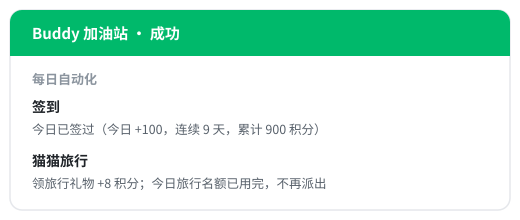
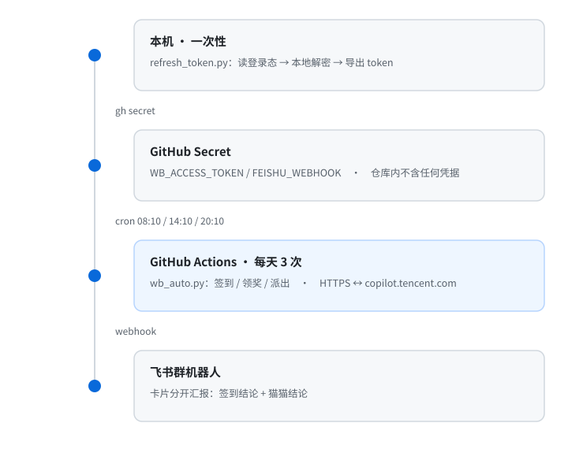

# workbuddy_auto_checkin

[](https://github.com/FXmonkey/workbuddy_auto_checkin/actions/workflows/daily.yml)


WorkBuddy「Buddy 加油站」的每日自动化：**签到领积分**、**派猫猫旅行并领回礼物**，结果推送到飞书。
跑在 GitHub Actions 上，每天触发三次，不需要任何常开设备。



## 特性

- **云端定时** — GitHub Actions 免费 runner，本机关机照常执行
- **时段冗余** — 08:10 / 14:10 / 20:10 三次触发互为备份，抵御 cron 的延迟与丢弃
- **幂等** — 先查状态再决定是否领取；已签不重领，已派不重派
- **结论解耦** — 猫猫模块任何异常都不影响签到结论；整体成败只看签到
- **零凭据入库** — 仓库不含任何密钥，token 由本机脚本导出后写入 Secret

## 工作原理

本机只在首次配置时参与：导出登录 token 并写入 GitHub Secret。此后每天的工作全部在云端完成，
每次运行先处理签到，再处理猫猫旅行。



### 为什么一天触发三次

GitHub 的 `schedule` 不是精确定时器。官方文档明确说明：高负载时定时任务会延迟，
**负载足够高时排队中的运行可能被直接丢弃**。单时段有丢失风险，所以设了三个时段互为备份。

| UTC | 北京时间 | 角色 |
| --- | --- | --- |
| `10 0 * * *` | 08:10 | 主时段 |
| `10 6 * * *` | 14:10 | 备份 |
| `10 12 * * *` | 20:10 | 备份 |

- **间隔 6 小时** — 旅行时长最长 4 小时（`travel/config` 的 `duration_hours_max`），
  下一轮运行时猫猫必定已到家，可领回礼物，不会出现「派了却没人领」
- **都落在 :10** — 避开 GitHub 文档提示的整点高负载期

多时段不会重复领取：脚本幂等，同日再跑只会得到「今日已签过」和「名额已用完，不再派出」。

### 为什么 token 必须在本机导出

桌面端把会话写在 `workbuddy-desktop.info` 里，其中 `accessToken` 是 Electron `safeStorage` 保护的
`$wbEncrypted` 信封（AES-256-GCM，密钥由客户端运行时持有）。云端 runner 既没有这份文件，
也没有解开它所需的运行时，因此**无法在云端现取 token**。

`refresh_token.py` 的做法是：读出加密信封 → 以 `ELECTRON_RUN_AS_NODE=1` 起一个 WorkBuddy 子进程 →
信封经 stdin 递入，由客户端自己的运行时解密 → 从 stdout 取回明文。解密材料全程不落盘。

## 快速开始

前置：本机装有 WorkBuddy 桌面端并已登录；Python 3.8+；一个飞书自定义机器人 webhook。

```bash
git clone https://github.com/FXmonkey/workbuddy_auto_checkin.git
cd workbuddy_auto_checkin

# 注入 token（有 gh CLI 时经 stdin 写入，不落命令行明文）
python refresh_token.py --gh-repo FXmonkey/workbuddy_auto_checkin
# 无 gh CLI 时脚本会打印 token 与手动配置指引，名称固定为 WB_ACCESS_TOKEN

# 注入飞书 webhook
gh secret set FEISHU_WEBHOOK --repo FXmonkey/workbuddy_auto_checkin \
  --body "https://open.feishu.cn/open-apis/bot/v2/hook/xxxxxxxx"

# 手动触发验证
gh workflow run daily.yml --repo FXmonkey/workbuddy_auto_checkin
```

也可在仓库 **Actions → Buddy 加油站每日自动化 → Run workflow** 触发。

## 配置项

### Actions 侧（`wb_auto.py`）

| 变量 | 必填 | 默认 | 说明 |
| --- | --- | --- | --- |
| `WB_ACCESS_TOKEN` | 是 | — | 访问令牌，缺失则退出（exit 2） |
| `FEISHU_WEBHOOK` | 建议 | — | 飞书机器人地址，缺失则不推送、仅打印日志 |
| `WB_ENDPOINT` | 否 | `https://copilot.tencent.com` | 接口地址 |
| `WB_RESULT_FILE` | 否 | — | 写入 Markdown 汇总表，供 step summary 使用 |

### 本机侧（`refresh_token.py`）

| 变量 | 说明 |
| --- | --- |
| `WORKBUDDY_AUTH_FILE` | 覆盖凭据文件路径 |
| `WORKBUDDY_EXE` | 覆盖客户端可执行文件路径 |

凭据文件按 `%LOCALAPPDATA%\CodeBuddyExtension\Data\Public\auth\workbuddy-desktop.info` 探测；
客户端按 `WORKBUDDY_EXE` → `%LOCALAPPDATA%\Programs\WorkBuddy\WorkBuddy.exe` → 常见盘根目录 →
注册表 `DisplayIcon` 的顺序探测。

## 行为与退出码

| 情况 | 行为 | `result` |
| --- | --- | --- |
| 今天未签到 | 调用领取接口 | `CLAIMED` |
| 今天已签到 | 不重复领取，读状态汇报 | `ALREADY` |
| 活动未开启 | 直接汇报，不做写操作 | `INACTIVE` |
| 猫猫已到家 | 先领这趟的旅行积分，再判断派出 | `DEPARTED` / `LIMIT_REACHED` |
| 猫猫在途中 | 汇报位置与预计到家时间，不派出 | `IN_TRIP` |
| 猫猫空闲且名额未用完 | 派出一趟 | `DEPARTED` |
| 今日名额已用完 | 读服务端 `daily_limit_reached`，不派出 | `LIMIT_REACHED` |
| 认证被拒（401/403） | 提示重新运行 `refresh_token.py` | `AUTH` |
| 网络不可达 | 有限重试后汇报，不误报成功 | `NETWORK` |
| 猫猫模块异常 | 捕获后单独汇报，不影响签到 | `ERROR` |
| 旅行状态取值未知 | 原样汇报，不做写操作 | `UNKNOWN_STATE` |
| 领取返回无法识别 | 汇报原始返回，不臆断成功 | `UNKNOWN` |

派出名额读服务端下发的 `daily_limit_reached`，而不是硬撞 `depart` 接口等它报错。

| 退出码 | 含义 |
| --- | --- |
| `0` | 签到成功 |
| `1` | 签到未达成（猫猫失败不在此列） |
| `2` | 缺少 `WB_ACCESS_TOKEN` |

workflow 中脚本以 `exit 0` 收尾，只对未完成项发 `::warning::`。因此**一次运行显示绿色不代表签到成功**，
以日志、step summary 与飞书卡片为准。

## 接口

均从客户端 `app.asar` 中核对并经线上实测，非网络流传版本。所有响应统一是 `{code, msg, data}` 信封，
业务字段在 `data` 内，脚本用 `unwrap()` 统一解包。

```text
POST /v2/billing/meter/checkin-activity-status   查询今日签到状态
POST /v2/billing/meter/daily-checkin             领取签到积分（已签返回 code 10001）

GET  /v2/activity/growth/buddy/travel/status     查询旅行状态
POST /v2/activity/growth/buddy/travel/claim      领取已到家的旅行积分
GET  /v2/activity/growth/buddy/travel/config     获取可派目的地
POST /v2/activity/growth/buddy/travel/depart     派出一趟
```

时间戳字段（`arrive_at` / `depart_at` / `server_now`）为**秒级**，与毫秒混用会算出错误的剩余时间。

## 项目结构

```text
wb_auto.py                    云端执行主体：签到、领奖、派出、推送
refresh_token.py              本机一次性操作：导出 token / 写入 Secret
.github/workflows/daily.yml   cron 定义与执行步骤
assets/                       README 配图
```

## 安全设计

- 仓库内不含任何凭据；token 只存在于 GitHub Secret 与运行时内存
- 解密助手只含固定代码，加密信封走 stdin、不经过 argv；密钥用后清零，不写临时文件
- 明文 token 不进入命令行、环境变量或日志（`--gh-repo` 模式下经 stdin 交给 `gh`）
- 所有响应打印前过 `masked()` 脱敏；写操作仅在网络异常时有限重试，靠服务端幂等避免重复提交

仓库可见性不影响运行：Actions 免费额度 public 无限、private 2000 分钟/月，本项目每月占用不足 1 分钟。

## 常见问题

**令牌过期** — token 有效期约 28 天（`expiresIn` 2419200）。出现「认证被拒」时本机重跑
`python refresh_token.py --gh-repo OWNER/REPO` 覆盖即可。

**Actions 页签看不到 workflow** — 确认 `.github/workflows/daily.yml` 已入库，且仓库 Actions 功能未被禁用。

**飞书没收到卡片** — 日志中 `[飞书]` 行会打印服务端返回码，`19001` 表示 webhook 地址无效或复制不完整。

**某个时段没跑** — cron 允许延迟与丢弃，个别时段缺席属正常，看当天是否**其它时段**跑过即可。
确认是否真的触发过：

```bash
curl -sS "https://api.github.com/repos/OWNER/REPO/actions/runs?per_page=20" \
  | grep -o '"event":"[a-z_]*"'
```

`schedule` 为定时触发，`workflow_dispatch` 为手动触发。

**定时任务被自动停用** — 仓库连续 60 天无活动时 GitHub 会自动禁用定时任务，长期无人值守需留意。

**偶发 302** — 高频轮询旅行状态时网关会短暂跳转，请求层已对 3xx 退避重试；按日频执行不会触发。

**非默认安装路径** — 用 `WORKBUDDY_EXE` 指定客户端，用 `WORKBUDDY_AUTH_FILE` 指定凭据文件。

## 已知限制

- 只覆盖签到与猫猫旅行；**不含**断登补签、连登兑换、盲盒、任务领取等成长中心其它玩法
- 依赖客户端私有接口，客户端升级可能改变接口或凭据格式，届时需更新脚本
- 仅支持 `sym-v1` / `suite 1` 格式的加密信封；其它格式明确返回 `UNSUPPORTED_ENVELOPE`，不发送无效请求
